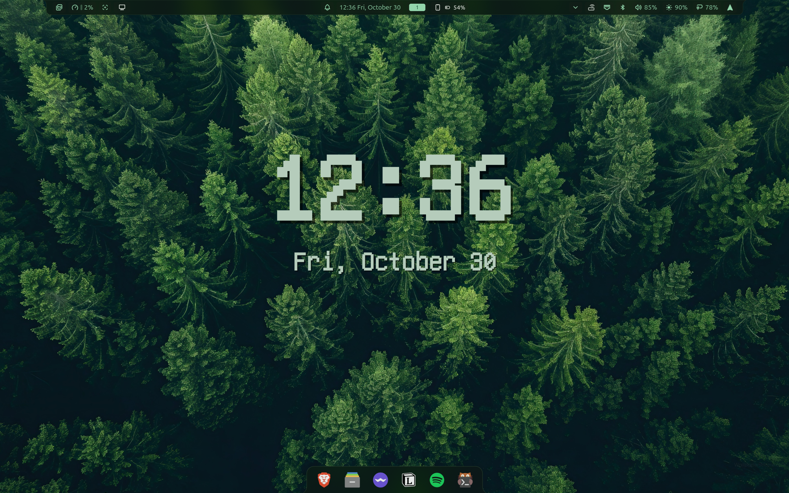

<div align="center">

# NixOS · Niri · Noctalia

A personal NixOS desktop, configured with flakes and Home Manager.

A scrolling Wayland desktop, a coordinated shell, and modular system configuration in one repository.

[Desktop](#desktop) · [Setup](#setup) · [Daily use](#daily-use) · [Customization](#customization) · [Troubleshooting](#troubleshooting)



</div>

## Desktop

### A coordinated workspace

[Niri](https://github.com/YaLTeR/niri) provides the scrolling tiling compositor. [Noctalia](https://github.com/noctalia-dev/noctalia-shell) supplies the bar, dock, desktop widgets, and shell integrations. Vicinae provides an application launcher, with Kitty and Fish for terminal work.

### Applications and development tools

The configuration includes Brave, Discord with Nixcord, Spotify with Spicetify, MPV, Nautilus, OBS, and other desktop applications. Development, gaming, virtualization, Tailscale, and KDE Connect are configured through separate modules. The enabled modules are listed in [the host configuration](modules/hosts/nixos/configuration.nix).

### One configuration, separate responsibilities

NixOS manages the system; Home Manager manages user applications and settings. `flake-parts` and `import-tree` organize the modules. Local subflakes pin Noctalia, Vicinae, and additional upstream sources. Machine values live in an ignored TOML file.

## Setup

This is a personal configuration for an **x86_64 Linux laptop with Intel/NVIDIA hybrid graphics**, UEFI boot, an ext4 root filesystem, and a FAT32 EFI partition mounted at `/boot`. It is intended to be adapted to an existing NixOS installation; it does not partition disks or install NixOS for you.

### 1. Prepare your NixOS installation

You need an existing user with `sudo` access, internet access, Git, and Nix with `nix-command` and `flakes` enabled. If needed, add this to your existing NixOS configuration and rebuild it before continuing:

```nix
nix.settings.experimental-features = [ "nix-command" "flakes" ];
```

Back up your current configuration and keep a working boot generation available.

### 2. Clone into your home directory

```bash
cd "$HOME"
git clone https://github.com/Tharusha-Gunarathne/nixos.git nixos
cd nixos
cp .env.local.example .env.local
chmod 600 .env.local
git config core.hooksPath .githooks
git config filter.noctalia-settings.required true
```

Repository access is required to clone. An authenticated SSH clone can be used instead.

### 3. Fill in your local configuration

Edit `.env.local` as **TOML**, not as a shell script. Do not `source` it. Keep the template’s sections and keys, and replace the machine values.

| Section | What to configure |
| --- | --- |
| `[user]` | Existing login name, UID, Git identity, and repository directory name. With the clone command above, use `repo_dir = "nixos"`. The configured repository path is `/home/<username>/<repo_dir>`. |
| `[storage]` | Real root and EFI partition UUIDs. Run `lsblk -f` to find them. |
| `[[storage.data_drives]]` | Actual NTFS data partitions and mount names. Remove unused entries; if you have no data drives, set `data_drives = []` inside `[storage]` before the next section. |
| `[hardware]` | Intel/NVIDIA PCI bus IDs and display dimensions. Inspect PCI devices with `lspci`; for example, `00:02.0` becomes `PCI:0:2:0`. Convert hexadecimal bus numbers to decimal for NVIDIA’s notation. |
| `[network]`, `[hotspot]` | DHCP or static addressing, Wi-Fi interface, and optional hotspot settings. |
| `[paths]`, `[noctalia]` | Existing wallpaper/avatar paths and output names for the bar and dock. In a running Niri session, use `niri msg outputs`. |
| `[locale]` | Your time zone, such as `Asia/Colombo`. |
| `[claude_sync]` | Shared directory appropriate for your machine; review the `claudeSync` module before enabling this workflow. |
| Credential sections | Supply credentials only for services you intend to use. The template documents optional values; Tailscale can be authenticated manually when its auth key is empty. |

Export the local file path in **each terminal used for manual Nix commands**:

```bash
export NIXOS_LOCAL_CONFIG="$PWD/.env.local"
```

The flake requires this variable and `--impure`. The template’s comment that no other steps are needed does not replace this requirement.

### 4. Adapt the host before building

Review these files against your hardware and existing NixOS configuration:

- [Host hardware](modules/hosts/nixos/hardware.nix): filesystem types, mounts, initrd modules, Intel microcode, and virtualization support. Compare with a hardware configuration generated for your own machine; this repository uses a flake module wrapper, so do not blindly replace it with an ordinary generated file.
- [Graphics](modules/features/hardware/graphics.nix): NVIDIA driver and PRIME offload. Machines with different GPUs need corresponding changes here, beyond editing PCI IDs.
- [Boot](modules/features/hardware/boot.nix): systemd-boot plus custom rEFInd installation and EFI registration. Review these writes to `/boot` before activation.
- [Power](modules/features/hardware/power.nix): machine-specific undervolting and power limits. For another machine, set `myConfig.isUnderVoltEnabled = false;` in the host module before applying.
- [Swap](modules/features/hardware/swap.nix): a 25 GiB swapfile at `/var/lib/swapfile`.
- [Enabled features](modules/hosts/nixos/configuration.nix): remove imports for applications or services you do not want. Review networking and shared-directory workflows as well.

Keep `system.stateVersion` and `home.stateVersion` consistent with your installation’s migration history; these are compatibility settings, not the current Nixpkgs release.

New source files must be added with `git add <file>` before a Git flake can see them. **Do not add `.env.local`.**

### 5. Check, build, and activate

Run from the repository root:

```bash
# Inspect the build/download plan; this does not build the system.
nix build '.#nixosConfigurations.nixos.config.system.build.toplevel' \
  --impure --dry-run --no-link

# Build the system without activating it.
nix build '.#nixosConfigurations.nixos.config.system.build.toplevel' \
  --impure --no-link

# Activate the configuration and add its boot generation.
sudo --preserve-env=NIXOS_LOCAL_CONFIG nixos-rebuild switch \
  --flake '.#nixos' --impure
```

Allow enough disk space and time for downloads and any local compilation. After a successful first activation, reboot to load the configured kernel and graphics driver, then log into the Niri session. Home Manager is integrated into the system rebuild; no separate `home-manager switch` is needed.

## Daily use

After the first activation, these installed helpers operate from the configured repository path:

```bash
nix-switch --plan          # Preview builds and downloads
nix-switch --show-trace    # Start a rebuild in a detached systemd service
nix-switch --logs          # Follow the rebuild; Ctrl-C stops the log viewer
nix-switch --status        # Inspect progress or the recent result
nix-clean                 # Collect unused store paths, retaining generations
```

`nix-switch` checks desktop binary-cache availability first. On a cache miss, retry later or explicitly allow local compilation with `nix-switch --allow-source-builds`. It temporarily disconnects an active Tailscale connection during rebuilding and attempts to restore it afterward. Successful switches schedule background garbage collection while retaining rollback generations. Separate weekly garbage collection removes generations older than 30 days.

### Keyboard shortcuts

On this desktop, `Mod` is the Super/Windows key. See [the Niri configuration](modules/features/software/niri/config.kdl) for the full bindings.

| Shortcut | Action |
| --- | --- |
| `Mod + Return` or `Mod + T` | Open Kitty |
| `Mod + O` | Toggle overview |
| `Mod + Q` | Close the focused window |
| `Mod + H / J / K / L` | Focus left / down / up / right |
| `Mod + Ctrl + H / J / K / L` | Move a column or window |
| `Mod + Shift + /` | Show the shortcut overlay |

## Customization

```text
.
├── flake.nix                    # Inputs and local TOML loading
├── flake.lock                   # Pinned input revisions
├── .env.local.example           # Machine configuration template
├── modules/
│   ├── systems.nix              # Supported build system
│   ├── hosts/nixos/             # Host wiring and hardware
│   └── features/
│       ├── core/                # Options, packages, users, rebuild helpers
│       ├── hardware/            # Boot, graphics, networking, power
│       ├── software/            # Applications, services, desktop shell
│       │   └── noctalia/
│       │       └── integrations/ # Noctalia hooks for other applications
│       └── user/                # GTK, XDG environment, desktop entries
├── plugins/
│   ├── noctalia/                # Shell and plugin input pins
│   ├── vicinae/                 # Launcher input pins
│   └── sources/                 # Source pins and binary release metadata
├── scripts/                     # Public-source checks
└── assets/                      # README desktop screenshot
```

`import-tree` discovers Nix files under `modules/`. Feature files expose named `flake.nixosModules` attributes; the host explicitly imports the features it uses. Add new feature modules there to enable them.

Common options, set inside the host’s NixOS module:

```nix
myConfig.shell.noctalia = true;     # Shell and guarded integrations
myConfig.isUnderVoltEnabled = false; # Disable custom CPU undervolting/limits
```

Niri’s configuration is linked to the checkout, and Noctalia settings are synchronized with repository files. Keep the checkout at the path declared by `[user]` and review desktop-generated changes before committing. Disabling Noctalia requires arranging any replacement shell or desktop components yourself.

### Update pinned inputs

```bash
export NIXOS_LOCAL_CONFIG="$PWD/.env.local"
nix flake update             # Update all top-level inputs
nix flake update noctalia    # Refresh the local Noctalia input
nix flake update vicinae     # Refresh the local Vicinae input
nix flake update sources     # Refresh the local source registry input
nix fmt                      # Format Nix files
nix-switch --plan
nix-switch --show-trace
```

The local subflakes define their own pins. To change an upstream version, edit or update the corresponding subflake first, then refresh its top-level input. For explicit source pins or binary releases in `plugins/sources/flake.nix`, update the revision/URL and matching hash together.

## Private configuration

Keep credentials and machine-specific details in the ignored `.env.local` with mode `0600`. Use the Git flake (`.#nixos`) and `NIXOS_LOCAL_CONFIG` as documented above. **Do not use `path:.` for this checkout:** it can copy ignored private files into the Nix store. `--no-link` avoids leaving a `result` symlink for standalone builds.

Local configuration is not encrypted secret storage. Values rendered into generated configurations can be readable in the Nix store. Keep private cache credentials outside the repository too.

After the first activation, Home Manager supplies the required `noctalia-settings` Git clean filter. Before staging synchronized Noctalia settings, confirm it is available:

```bash
git config --get filter.noctalia-settings.clean
python3 scripts/check-public-source.py
python3 scripts/check-public-source.py --history
git diff --cached
```

If Python is unavailable before activation, enter `nix-shell -p python3` to run the checks. The required filter deliberately prevents staging settings when its cleaner is missing. Review changes yourself as well; automated checks cannot identify every private value.

## Troubleshooting

| Symptom | What to check |
| --- | --- |
| “Local configuration not found” | Export the absolute `NIXOS_LOCAL_CONFIG` path, confirm the file exists, and pass `--impure`. Preserve the variable when using `sudo`. |
| A new module is missing | Add the source file to Git and import its module in the host configuration. |
| A desktop cache is unavailable | Retry later or use `nix-switch --allow-source-builds` if you are prepared to compile. |
| Rebuild terminal closes | The helper runs in `nix-switch.service`; reconnect and use `nix-switch --status` or `--logs`. |
| Login succeeds but the screen stays black | Inspect `journalctl -b -u display-manager` and `journalctl --user -b`. Keep Niri on the system package dependency set (`pkgs.niri-unstable` here) so graphics libraries match the installed driver. |
| Low disk space | Run `df -h /nix/store` and `nix-clean`. `nix-clean -d` also deletes old generations and their rollback options. |

To return to the previous system generation from a working terminal:

```bash
sudo nixos-rebuild switch --rollback
```

If the desktop is unavailable, use a TTY (`Ctrl + Alt + F3`) or select a previous NixOS generation from the boot menu. System rollback does not restore mutable files in the checkout or application data.
